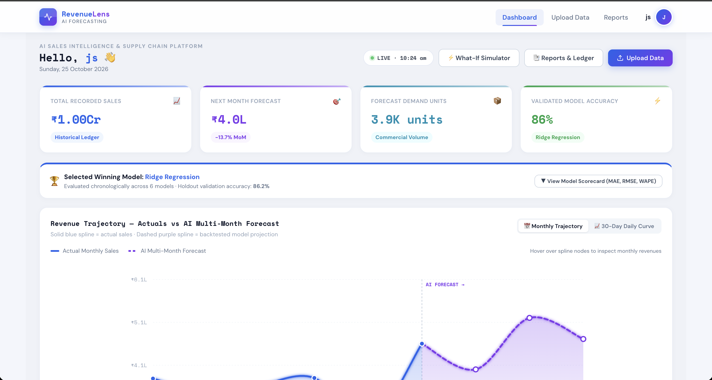
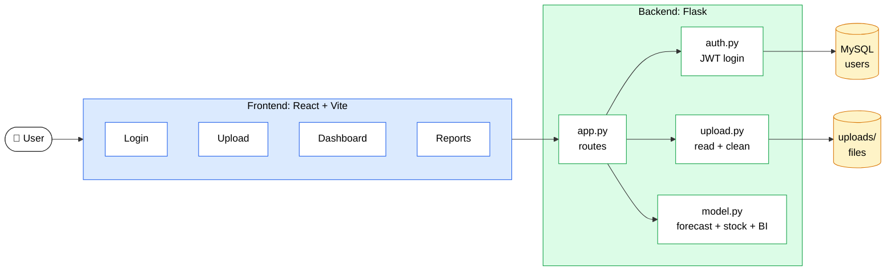
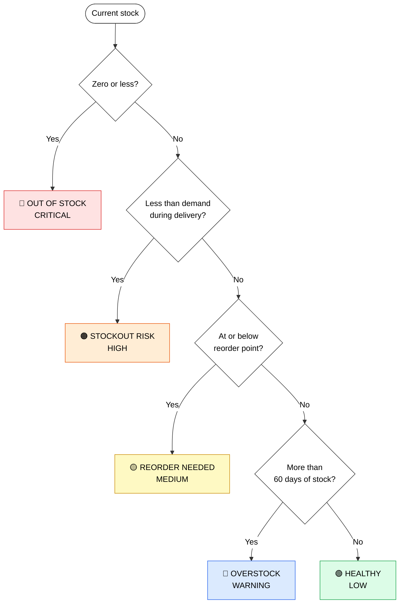

<div align="center">  <br/>
AI Sales Intelligence & Supply Chain Platform

Forecast your sales. Plan your stock. Never run out.

     <br/>

Features · Architecture · How it works · Setup · API · Limits

</div>

---

## 🤔 What is RevenueLens?

Upload your sales file (CSV or Excel). RevenueLens will:

- 📈 **Forecast** your sales for the next 30 days and 3 months
- 📦 **Tell you when and how much to reorder**
- 🚨 **Flag unusual sales days**
- 💡 **Show insights**: top products, best weekdays, What-If scenarios

<div align="center">

<br/><sub><b>Dashboard:</b> sales KPIs, winning model, and actual vs forecast chart</sub>
</div>

---

## ✨ Features

| Feature | What it does |
|---|---|
| 🔮 **Forecast** | 3-month and 30-day forecast with a high/low safe range |
| 🏁 **6 models compete** | The best one for your data is chosen automatically |
| 📦 **Stock planning** | Safety stock, reorder point, order quantity, risk level |
| 🚨 **Anomaly alerts** | Spikes and dips with HIGH / MEDIUM / LOW level |
| 🏆 **80/20 analysis** | The few products that bring most of your money |
| 📅 **Weekday pattern** | Which days sell the most |
| 🎛 **What-If tool** | Change demand, delivery time and service level, see results at once |
| 💾 **Export** | CSV, JSON and PDF |

---

## 🏗 Architecture



```text
RevenueLens/
├── backend/   app.py · auth.py · config.py · model.py · upload.py · tests/ · uploads/
└── frontend/  src/pages (Dashboard, Reports, UploadData, Login) · components · assets
```

---

## 🔬 How it works

```mermaid
%%{init: {'theme':'base','themeVariables':{'primaryTextColor':'#000000','textColor':'#000000','lineColor':'#333333','primaryColor':'#DBEAFE','primaryBorderColor':'#2563EB'}}}%%
flowchart LR
    A[1. Upload<br/>CSV / Excel] --> B[2. Clean<br/>+ remove duplicates]
    B --> C[3. Group by<br/>day and month]
    C --> D[4. Test<br/>6 models]
    D --> E[5. Pick<br/>lowest error]
    E --> F[6. Forecast<br/>stock, alerts, insights]

    style A fill:#DBEAFE,stroke:#2563EB,color:#000000
    style B fill:#DBEAFE,stroke:#2563EB,color:#000000
    style C fill:#DBEAFE,stroke:#2563EB,color:#000000
    style D fill:#FEF9C3,stroke:#CA8A04,color:#000000
    style E fill:#FEF9C3,stroke:#CA8A04,color:#000000
    style F fill:#DCFCE7,stroke:#16A34A,color:#000000
```



**The 6 models:** Ridge Regression · Gradient Boosting · Ridge + Boosting blend · Holt's Smoothing · Naive (same as last period) · Seasonal Naive (same as last cycle).
Models are tested in **time order** (walk-forward). The one with the lowest **WAPE** wins.

### Why accuracy improved (from 40–75% to 85–92%+)

| Old problem | Fix |
|---|---|
| Model compared neighbouring invoices, not real days | Sales are **added up per day and month** first |
| A few near-zero sales days made the error look huge (MAPE) | Use **WAPE** (total error ÷ total sales) and **MASE** (are we better than "same as last period"?) |
| One model for every business | **6 models** compete, best one wins |

> 📘 **Example:** you sold 1,000 units and the forecast missed by 100 in total. That is a 10% error, so about 90% accurate.

---

## 📦 Inventory

> [!IMPORTANT]
> Current stock is **never invented**. If your file has no stock column, results are marked `CONFIGURED_BASELINE`. If it comes from your file, it is `DATA_PROVIDED`.

| Term | Simple meaning | How it is worked out |
|---|---|---|
| **Safety Stock** | Extra stock kept for surprises | Bigger when daily sales jump around a lot, delivery is slow, or you want a higher service level |
| **Reorder Point** | The stock level at which you should order again | Sales during delivery time + safety stock |
| **Order Quantity** | How many units to order | Enough to reach the reorder point plus 30 days of sales |

> 📘 **Example:** you sell 10 units a day, delivery takes 7 days, and safety stock is 15. Reorder when stock falls to **85** (10 × 7 + 15).



---

## 🚨 Anomalies and insights

- **How anomalies are found:** compare each day with a 7-day rolling median. Days far outside the normal range (IQR method) are flagged.
- **Spike:** 30%+ above normal. **Dip:** 55%+ below normal. Each gets a HIGH / MEDIUM / LOW level and a short reason.
- **What-If tool:** demand ±50% · delivery time 1–60 days · service level 80–99%.

---

## 🚀 Setup

**Requirements:** Node.js 18+, Python 3.10+, MySQL (needed only for login).

```bash
# Backend  (http://localhost:5000)
cd backend
python3 -m venv venv
source venv/bin/activate          # Windows: venv\Scripts\activate
pip install -r requirements.txt
python app.py
```

```bash
# Frontend  (http://localhost:5173) - open a new terminal
cd frontend
npm install
npm run dev
```

```bash
# Tests
cd backend && PYTHONPATH=. python -m unittest discover tests
```

> [!WARNING]
> Set your database details and JWT secret in `backend/.env`. Never commit real passwords.

---

## 🔌 API

| Method | Endpoint | Purpose |
|:-:|---|---|
| POST | `/api/upload` | Upload `.csv` / `.xlsx`. Returns detected columns, row counts, duplicates removed, preview |
| POST | `/api/forecast` | Full pipeline. Body: `{ file_path, lead_time_days, service_level, demand_shock_pct }` |
| GET | `/api/health` | Server status and uptime |
| POST | `/api/login` | Log in, returns JWT |
| POST | `/api/register` | Create account |

---

## ⚠️ Limits

| Situation | What happens |
|---|---|
| Less than 4 months of data | Falls back to a simple naive model with lower confidence |
| No stock column in the file | Uses your settings, marked `CONFIGURED_BASELINE` |
| Sudden big events (crisis, pandemic) | Cannot be predicted from past data alone |
| Accuracy (85–92%+) | Measured on tested datasets. Your result depends on your data, so check the in-app model score |

---

 
